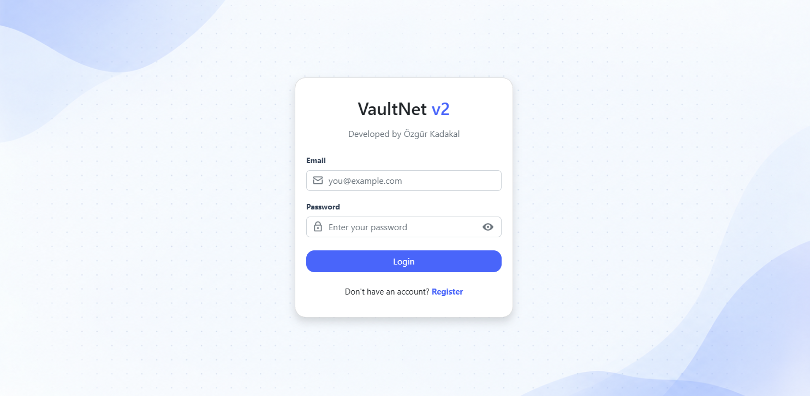
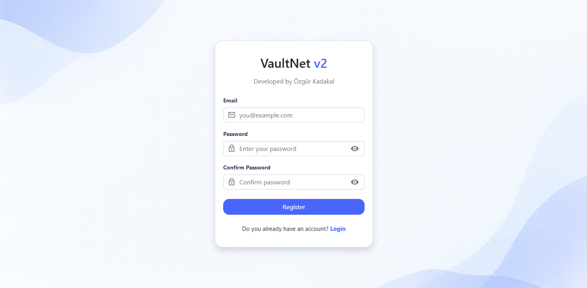
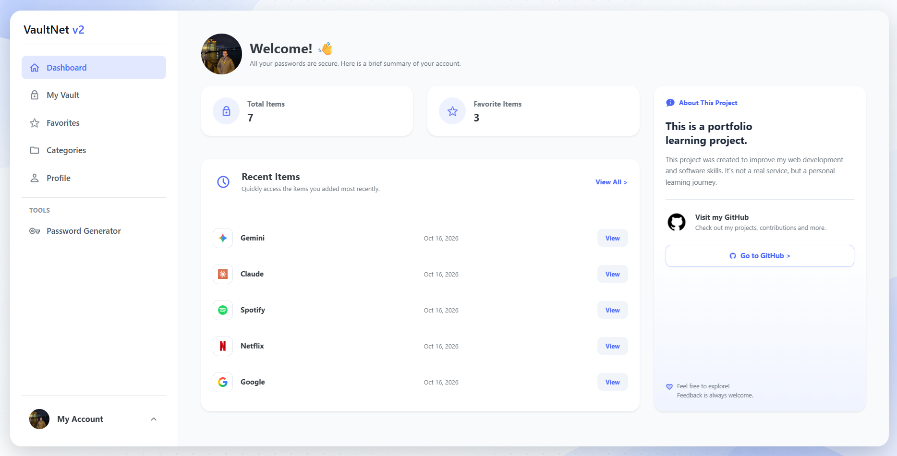
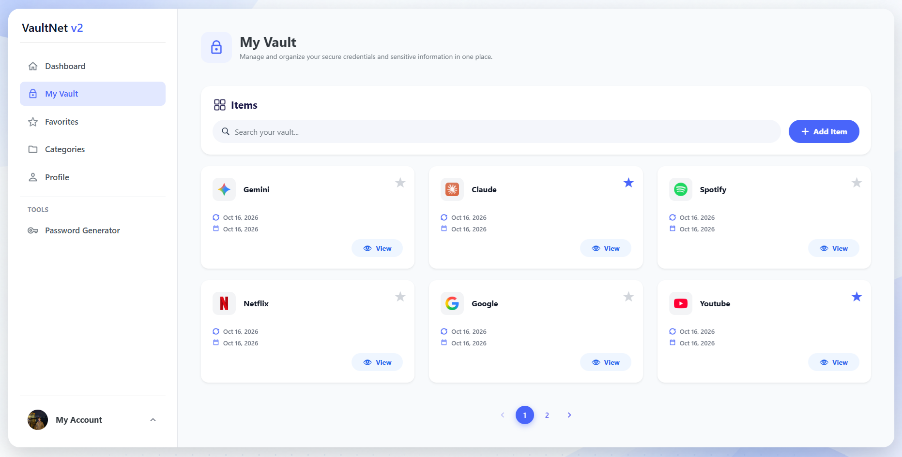
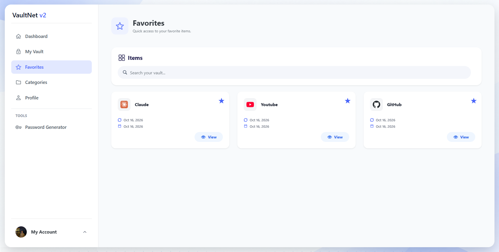
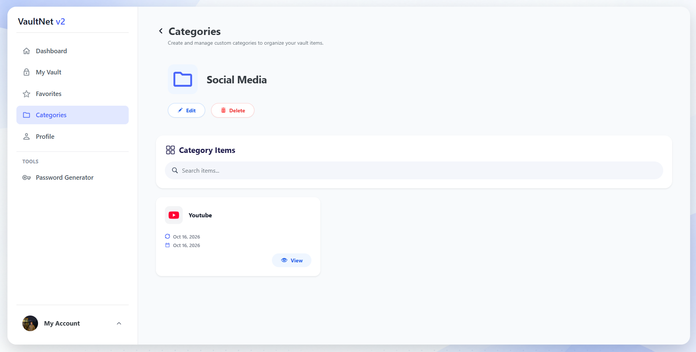
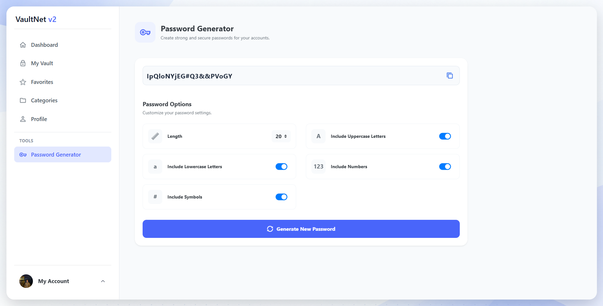
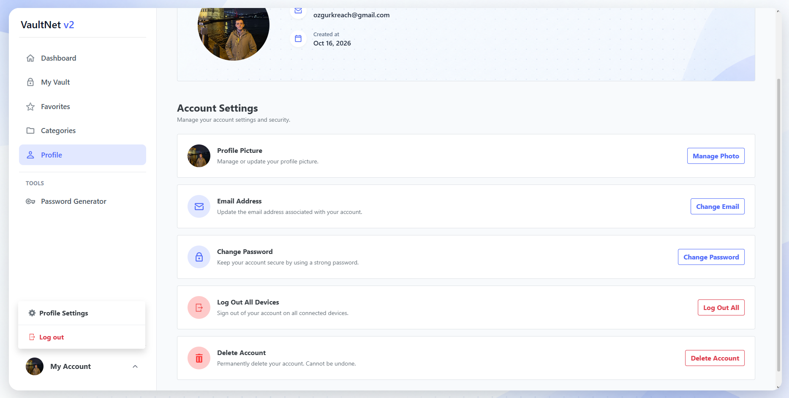
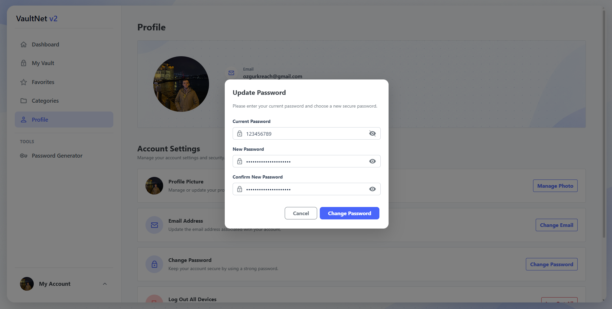
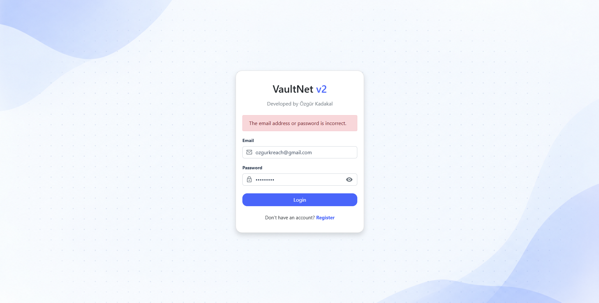

# 🔐 VaultNet v2 - Secure Password Manager & Digital Vault 🛡️

### Developed by Özgür Kadakal

> **🌐 Live Demo:** [https://vaultnet-v2-kadakalozgur.vercel.app](https://vaultnet-v2-kadakalozgur.vercel.app)  
> *(Note: Hosted on Azure App Service Free Tier in Southeast Asia. If the API has been idle for 20+ minutes, the initial request may take 10–15 seconds to wake the server from sleep mode.)*

> **⚠️ Important:** This project uses **PostgreSQL (Supabase)**, **Supabase Storage**, and **ASP.NET Core Data Protection**. Before running locally, you must configure your database connection, JWT settings, and Supabase credentials in `appsettings.json`.

> ⚠️ **DISCLAIMER & SECURITY NOTICE:**  
> **VaultNet v2 is an open-source educational portfolio and proof-of-concept project.** It is **not** an officially certified commercial password vault. The author assumes no legal liability for data breaches, data loss, or compromised accounts resulting from the use of this software.

---

# 🖼️ Previews & Application Showcase

## 🔑 1. Login Screen
> Secure authentication with credential validation and rate-limiting protection.



---

## 📝 2. Registration Screen
> User onboarding with email normalization, unique email verification, and BCrypt password hashing.



---

## 📊 3. Dashboard Overview
> Real-time summary displaying total vault items, favorite counts (cached via `sessionStorage`), and the 5 most recently added items.



---

## 🗄️ 4. My Vault (Encrypted Items & Pagination)
> Paginated list (fixed 6 items per page) featuring title search, website favicons, show/hide password toggles, and one-click clipboard copy.



---

## ⭐ 5. Favorites
> Quick access view filtering all vault items marked as favorites.



---

## 📂 6. Categories Management
> Encrypted category listing with search, pagination, rename, delete, and dedicated category detail views.



---

## 🎲 7. Cryptographic Password Generator
> Customizable password generator powered by the browser's `window.crypto.getRandomValues` API.



---

## 👤 8. Profile & Cloud Avatar Management
> Manage account details, upload/remove profile pictures via Supabase Storage, change email/password, or permanently delete the account.



---

## 🪟 9. Interactive Modal & Locked UI States
> Clean modal workflow for adding/editing/viewing items. Interactive elements automatically lock during active API requests to prevent duplicate submissions.



---

## 🚨 10. In-Page Alerts & Rate Limit (429) Handling
> User-friendly in-page alert boxes for validation warnings, server errors, and `429 Too Many Requests` rate-limit notifications.



---

# 🔐 About VaultNet v2

**VaultNet v2** is a full-stack, security-focused password manager and digital vault application built with **ASP.NET Core 8.0 Web API** on the backend and **Vanilla JavaScript + Bootstrap** on the frontend.

---

# ✨ Features

## 🔐 Account & Session Management
- **Secure Registration & Login:** Email normalization, unique email enforcement, and password hashing using **BCrypt**.
- **Hardened Cookie Authentication:** Short-lived **Access Tokens (5 min)** and **Refresh Tokens (30 min)** stored strictly in `HttpOnly`, `Secure`, `SameSite=Strict` cookies.
- **Refresh Token Rotation:** Every token refresh invalidates the previous token and issues a brand-new pair.
- **Token Reuse Detection:** If a revoked/used refresh token is replayed (indicating potential token theft), the system immediately **terminates all active sessions** for that user across all devices.
- **Silent Background Refresh (Concurrency Safe):** Automatic background token renewal on `401 Unauthorized`. Simultaneous 401 responses on the frontend are queued so only a **single refresh request** is dispatched.
- **SecurityStamp Validation:** Changing the password/email or clicking *"Logout from all devices"* updates the user's `SecurityStamp`, instantly invalidating all existing Access Tokens without waiting for their 5-minute expiration.
- **Multi-Device Support:** Per-device isolated refresh token tracking with single-device logout or global session termination.

---

## 🗄️ Password Vault & Categories
- **Full CRUD Operations:** Store, view, edit, and delete vault items (Title, Username/Email, Password, Website/Domain, Category).
- **Database-Level Encryption:** All sensitive fields (Titles, Usernames, Passwords, Domains, and **Category Names**) are encrypted prior to database persistence using **ASP.NET Core Data Protection**.
- **Favorites & Search:** Mark items as favorites with a dedicated Favorites page, search by title, and browse with fixed server-side pagination (**6 items per page**).
- **Interactive UI Helpers:** Show/hide password toggle, one-click copy to clipboard, and automatic website **favicon** fetching with a safe fallback icon for invalid domains.
- **Transactional Category Management:** Create, list, search, paginate, rename, and delete categories. Deleting a category executes inside a **database transaction**—items inside are never lost; they are safely detached as *Uncategorized*. Strict category ownership verification is enforced on every operation.

---

## 📊 Dashboard, Profile & Password Generator
- **Real-Time Dashboard:** Displays total vault items, favorite counts, and the 5 most recently added items.
- **Smart Client-Side Caching:** Dashboard statistics and profile metadata are cached in `sessionStorage` and automatically invalidated whenever a vault item or profile setting is modified, keeping the avatar and counters synchronized across pages.
- **Profile & Cloud Avatar Management:** View account details, upload/remove profile pictures via **Supabase Storage**, update email or password (with current password verification), and permanently delete the account (with password confirmation and automated cleanup of cloud storage assets).
- **Cryptographic Password Generator:** Customizable length and character pools (uppercase, lowercase, digits, symbols) powered by the browser's cryptographically secure pseudo-random number generator (`window.crypto.getRandomValues`).

---

## 🛡️ Security, Observability & UX
- **Multi-Policy Rate Limiting:** Granular protection across endpoints returning a standardized JSON payload with `429 Too Many Requests` and clear UI alerts when limits are exceeded:

| Policy | Limit | Scope / Partition | Purpose |
| :--- | :--- | :--- | :--- |
| **Auth** | `10 req / min` | IP-Based | Protects login/register against Brute Force & Credential Stuffing |
| **Read** | `60 req / min` | User-Based | Balances smooth browsing with scraping protection |
| **Write** | `20 req / min` | User-Based | Prevents automated vault/category spam |
| **Profile** | `5 req / min` | User-Based | Strictly throttles sensitive account & avatar mutations |
| **Global Concurrency** | `100 concurrent` | Global | Protects server resources against traffic spikes |

- **Strict Tenant Isolation:** Every database query is strictly scoped to the authenticated `UserId`—cross-user data access is impossible.
- **Frontend & Transport Hardening:** XSS output escaping, HTTPS redirection, HSTS, and strict credentialed CORS policies.
- **Global Exception Handling:** Standardized error responses ensuring internal stack traces never leak to the client.
- **Privacy-First Structured Logging (Serilog):**
  - Logs requests with `ClientIp` and `RequestId` to both Console and rolling local files.
  - Tracks critical security events: successful/failed logins, token reuse anomalies, global logouts, and credential changes.
  - **Sensitive Data Masking:** User emails are masked in logs (e.g., `o***h@gmail.com`). Passwords, tokens, and decrypted vault contents are **never** written to logs.
- **Polished User Experience:** Responsive Bootstrap UI, animated page loaders, disabled/locked modal inputs during async processing, and clear in-page alert boxes.

---

# 🧠 Architectural & Engineering Decisions

### 1. SOLID Principles & Decoupled Cloud Storage (`IStorageService.cs`)
Profile avatars are stored externally in **Supabase Storage** to keep the backend stateless and prevent local disk exhaustion.  
- **Engineering Note:** While running the default codebase out-of-the-box requires a Supabase project, the storage layer is strictly designed around **SOLID principles (Dependency Inversion & Open/Closed)**. File operations are abstracted behind the `IStorageService` (`IStorageService.cs`) interface. If you do not wish to use Supabase, you can easily implement `IStorageService` for any provider (e.g., AWS S3, Azure Blob Storage, Cloudinary, or Local File System) and swap the dependency injection registration in `Program.cs` without modifying a single line of business logic.

### 2. Server-Side Encryption vs. Zero-Knowledge Architecture
Vault items and category names are encrypted on the backend using **ASP.NET Core Data Protection**, with the cryptographic key ring persisted in the PostgreSQL database (`DataProtectionKeys` table).  
- **Engineering Note:** While production-grade commercial password managers utilize a client-side **Zero-Knowledge** architecture, server-side encryption was deliberately chosen to match the scope and timeline of this project. For a commercial release handling real user secrets at scale, transitioning to client-side Zero-Knowledge encryption would be the natural next step.

### 3. Lazy Decryption & Query Projection (`GetItemsAsync`)
In the Vault listing endpoint (`VaultController`), two critical performance and security optimizations were implemented:
- **Hard-Coded PageSize:** Pagination is strictly locked to **6 items per page** on the backend. Allowing arbitrary client-supplied `pageSize` parameters (e.g., `?pageSize=9999`) would defeat pagination and enable database/CPU exhaustion attacks.
- **Minimal Projection & On-Demand Decryption:** `Password` and `Username` are **never** fetched or decrypted in list views; they are only retrieved when the user explicitly clicks the **"View"** button for a specific item. `Title` and `Domain` (required for rendering website favicons) are decrypted only for the visible 6-item page (while search queries decrypt titles in memory to perform matching). This drastically reduces database I/O and CPU cryptographic overhead.

### 4. Refresh Token Lifetimes & The 2-Day Inline Cleanup Trade-Off
Because VaultNet is a high-security application, token lifetimes are intentionally short (**5 minutes** for Access Tokens, **30 minutes** for Refresh Tokens).
- To prevent the `RefreshTokens` table from growing indefinitely without spinning up a separate background worker (`IHostedService`), an inline cleanup runs directly during login and token refresh requests to purge tokens older than **2 days**.
- **Why 2 Days?** Since a refresh token expires in 30 minutes, keeping expired/revoked tokens for 48 hours provides an optimal window for **Token Reuse Detection** (catching stolen tokens and revoking all user sessions) without bloating the database. After 2 days, a purged token still cannot be used to authenticate (as it is long expired), though it will no longer trigger an automated global session wipe—an intentional and practical architectural trade-off.

### 5. Cloud Resource Protection & Reverse Proxy Architecture
- **First-Party Cookie Proxy:** The frontend (Vercel) proxies `/api/*` requests directly to the backend (Azure App Service) via `vercel.json` rewrites. This allows the browser to treat authentication cookies as first-party (`SameSite=Strict`) without paying for a custom domain.
- **Log Retention Cap:** Although the standard retention policy is designed for 14 days in normal environments, to prevent exhausting the **1 GB disk limit** on Azure App Service Free Tier (F1), Serilog is strictly capped in production at a **daily rolling interval**, a **maximum of 3 retained files** (`retainedFileCountLimit: 3`), and a **5 MB file size limit** (`fileSizeLimitBytes: 5242880` with `rollOnFileSizeLimit: true`), guaranteeing log storage never exceeds ~15 MB.
- **Free Tier Cold Starts & Region Latency:** Due to free tier availability, the Azure App Service instance is hosted in **Southeast Asia** and enters sleep mode after 20 minutes of inactivity. Initial requests after idle periods will naturally experience a brief cold-start delay.

---

# ⚙️ Local Setup & Configuration

## 1️⃣ Clone the Repository
```bash
git clone [https://github.com/kadakalozgur/VaultNet-v2.git](https://github.com/kadakalozgur/VaultNet-v2.git)
cd VaultNet-v2
```

## 2️⃣ Required NuGet Packages (.NET 8.0)
When you open the backend project in **Visual Studio 2022**, NuGet packages are restored automatically. Below is the complete package list used in the API:

| Package | Version | Purpose |
| :--- | :--- | :--- |
| `BCrypt.Net-Next` | `4.2.0` | Secure password hashing |
| `Microsoft.AspNetCore.Authentication.JwtBearer` | `8.0.30` | JWT authentication middleware |
| `Microsoft.AspNetCore.DataProtection.EntityFrameworkCore` | `8.0.30` | Persisting Data Protection key ring in DB |
| `Microsoft.EntityFrameworkCore` | `8.0.30` | Core ORM framework |
| `Microsoft.EntityFrameworkCore.Tools` | `8.0.30` | EF Core migration tools |
| `Npgsql` | `8.0.9` | .NET data provider for PostgreSQL |
| `Npgsql.EntityFrameworkCore.PostgreSQL` | `8.0.11` | PostgreSQL provider for EF Core |
| `Serilog.AspNetCore` | `8.0.3` | Structured console & rolling file logging |
| `supabase-csharp` | `0.16.1` | Supabase Storage integration for profile avatars |
| `Swashbuckle.AspNetCore` | `6.6.2` | Swagger / OpenAPI documentation |

To install manually via **Package Manager Console**:
```powershell
Install-Package BCrypt.Net-Next -Version 4.2.0
Install-Package Microsoft.AspNetCore.Authentication.JwtBearer -Version 8.0.30
Install-Package Microsoft.AspNetCore.DataProtection.EntityFrameworkCore -Version 8.0.30
Install-Package Microsoft.EntityFrameworkCore -Version 8.0.30
Install-Package Microsoft.EntityFrameworkCore.Tools -Version 8.0.30
Install-Package Npgsql -Version 8.0.9
Install-Package Npgsql.EntityFrameworkCore.PostgreSQL -Version 8.0.11
Install-Package Serilog.AspNetCore -Version 8.0.3
Install-Package supabase-csharp -Version 0.16.1
Install-Package Swashbuckle.AspNetCore -Version 6.6.2
```

## 3️⃣ Configure `appsettings.json` & Storage
Update the `appsettings.json` file in the API project with your own PostgreSQL connection string, JWT secret, frontend URL, and Supabase credentials:

```json
{
  "ConnectionStrings": {
    "DefaultConnection": "Host=YOUR_HOST;Port=5432;Database=postgres;Username=postgres;Password=YOUR_PASSWORD"
  },
  "JwtSettings": {
    "SecretKey": "your-super-secret-key-at-least-32-bytes-long",
    "Issuer": "VaultNetServer",
    "Audience": "VaultNetClient",
    "ExpireMinutes": 5
  },
  "CorsSettings": {
    "AllowedOrigins": [
      "[http://127.0.0.1:5500](http://127.0.0.1:5500)"
    ]
  },
  "Supabase": {
    "Url": "[https://your-project-id.supabase.co](https://your-project-id.supabase.co)",
    "Key": "your-supabase-api-key"
  }
}
```
> 💡 **Note on Token Lifetimes & Storage:**
> - You can customize the Access Token and Refresh Token lifetimes inside `appsettings.json` (`ExpireMinutes`) and `AuthController`.
> - **Supabase Storage:** The default implementation requires a Supabase project for storing profile pictures. If you do not want to use Supabase, simply create a custom storage service implementing `IStorageService.cs` (SOLID compliant) and register it in `Program.cs`.

> 🚨 **CRITICAL WARNING (`SetApplicationName`):**  
> In `Program.cs`, the Data Protection configuration contains `.SetApplicationName("VaultNetAPI")`. **Never modify or misspell this string once data has been encrypted!** Changing even a single character causes ASP.NET Core Data Protection to reject existing keys and generate a new key ring, rendering all previously encrypted vault items in the database permanently unrecoverable.

## 4️⃣ Apply Database Migrations
Open **Package Manager Console** in Visual Studio and run:
```powershell
Update-Database
```

## 5️⃣ Configure Frontend (`config.js`)
Open the frontend folder in **Visual Studio Code**, locate `config.js`, and update the API URL to point to your local backend address. Then launch the UI using the **Live Server** extension.

---

# 🛠 Tech Stack & Tools

| Category | Technology / Tool |
| :--- | :--- |
| **Backend Language & Framework** | C# / ASP.NET Core 8.0 Web API |
| **Frontend** | HTML5, CSS3, Vanilla JavaScript, Bootstrap |
| **Database & Cloud Storage** | PostgreSQL & Supabase Storage |
| **ORM** | Entity Framework Core (Code-First) |
| **Authentication & Cryptography** | JWT (HttpOnly Cookies), BCrypt, ASP.NET Core Data Protection |
| **Security & Observability** | ASP.NET Core Rate Limiting, Serilog |
| **Cloud Hosting** | Vercel (Frontend + Reverse Proxy), Azure App Service F1 (Backend API) |
| **IDEs & Testing Tools** | Visual Studio 2022, Visual Studio Code (Live Server), Swagger UI, Postman |

---

# 📚 Additional Notes
- This project was engineered from scratch by **Özgür Kadakal** to practice secure full-stack architecture, cryptographic data protection, SOLID design principles, and advanced session management.
- AI-assisted tools were utilized during the development workflow.

---

# 📬 Contact
For feedback, questions, or suggestions:

📧 **ozgurkreach@gmail.com**

---

---

# 🇹🇷 Türkçe

# 🔐 VaultNet v2 - Güvenli Şifre Yöneticisi ve Dijital Kasa 🛡️

### Geliştirici: Özgür Kadakal

> **🌐 Canlı Demo (Live):** [https://vaultnet-v2-kadakalozgur.vercel.app](https://vaultnet-v2-kadakalozgur.vercel.app)  
> *(Not: Backend, Güneydoğu Asya bölgesindeki ücretsiz Azure App Service F1 planında barındırılmaktadır. Sunucu 20 dakika boyunca istek almazsa uyku moduna geçtiği için ilk isteğinizde 10–15 saniyelik bir uyanma gecikmesi yaşanabilir.)*

> **⚠️ Önemli:** Bu proje **PostgreSQL (Supabase)**, **Supabase Storage** ve **ASP.NET Core Data Protection** kullanır. Projeyi yerel ortamda çalıştırmadan önce `appsettings.json` dosyasındaki veritabanı, JWT ve Supabase ayarlarını yapılandırmanız gerekmektedir.

> ⚠️ **YASAL UYARI VE GÜVENLİK BİLGİLENDİRMESİ:**  
> **VaultNet v2, kişisel portföy ve konsept kanıtlama amacıyla geliştirilmiş açık kaynaklı bir eğitim projesidir.** Ticari veya sertifikalı bir şifre yöneticisi değildir. Uygulamanın kullanımından doğabilecek olası veri kayıplarından, güvenlik açıklarından veya hesap ihlallerinden geliştirici sorumlu tutulamaz.

---

# 🖼️ Önizlemeler & Uygulama Görselleri

## 🔑 1. Giriş (Login) Ekranı
> Kimlik doğrulama ve Rate Limiting korumalı güvenli giriş ekranı.


---

## 📝 2. Kayıt (Register) Ekranı
> Email normalizasyonu, benzersiz email kontrolü ve BCrypt şifre hashleme destekli kayıt ekranı.


---

## 📊 3. Dashboard Genel Bakış
> Toplam kasa öğesi, favori sayısı (`sessionStorage` önbellekli) ve son eklenen 5 kaydı gösteren özet ekranı.


---

## 🗄️ 4. Şifre Kasam (My Vault)
> Sabit 6 kayıtlık sayfalama, başlığa göre arama, site faviconları, şifre göster/gizle ve panoya kopyalama özellikli kasa ekranı.


---

## ⭐ 5. Favoriler (Favorites)
> Favori olarak işaretlenen kasa kayıtlarına hızlı erişim sayfası.


---

## 📂 6. Kategoriler (Categories)
> Şifreli kategori listeleme, arama, sayfalama, yeniden adlandırma, silme ve kategori detay sayfası.


---

## 🎲 7. Kriptografik Şifre Üretici (Password Generator)
> Tarayıcının `window.crypto.getRandomValues` altyapısını kullanan özelleştirilebilir şifre üretici.


---

## 👤 8. Profil & Bulut Avatar Yönetimi
> Hesap bilgileri, Supabase Storage ile profil fotoğrafı yükleme/kaldırma, email/şifre güncelleme ve hesap silme ekranı.


---

## 🪟 9. Etkileşimli Modal Ekranı
> Kayıt ekleme/düzenleme/görüntüleme modalları. İşlem sırasında mükerrer istekleri önlemek için buton ve inputlar otomatik olarak kilitlenir.


---

## 🚨 10. Sayfa İçi Uyarı (Alert) & Hata Mesajları
> Hata durumlarında, doğrulama uyarılarında ve `429 Too Many Requests` (Rate Limit) aşımlarında gösterilen anlaşılır uyarı kutuları.


---

# 🔐 VaultNet v2 Hakkında

**VaultNet v2**, arka uçta **ASP.NET Core 8.0 Web API**, ön yüzde ise **Vanilla JavaScript ve Bootstrap** kullanılarak geliştirilmiş, güvenlik odaklı uçtan uca (full-stack) bir şifre yöneticisi ve dijital kasa uygulamasıdır.

---

# ✨ Özellikler

## 🔐 Hesap ve Oturum Yönetimi
- **Güvenli Kayıt ve Giriş:** Email normalizasyonu, benzersiz email kontrolü ve **BCrypt** ile şifre hash’leme.
- **Sıkılaştırılmış Cookie Kimlik Doğrulaması:** `HttpOnly`, `Secure` ve `SameSite=Strict` bayraklarına sahip çerezlerde saklanan kısa ömürlü **Access Token (5 dk)** ve **Refresh Token (30 dk)** yapısı.
- **Refresh Token Rotation:** Her oturum yenilemesinde eski refresh token iptal edilir ve tamamen yeni bir token çifti üretilir.
- **Token Yeniden Kullanım Tespiti:** İptal edilmiş veya daha önce kullanılmış bir refresh token tekrar gönderilirse (token çalınma şüphesi), sistem ilgili kullanıcının **tüm cihazlardaki aktif oturumlarını anında sonlandırır**.
- **Arka Planda Otomatik Oturum Yenileme:** Arayüzde aynı anda birden fazla `401 Unauthorized` hatası alındığında istekler kuyruğa alınır ve sunucuya **yalnızca tek bir refresh isteği** atılarak oturum kesintisiz yenilenir.
- **SecurityStamp Doğrulaması:** Şifre/email değiştirildiğinde veya *"Tüm cihazlardan çıkış yap"* denildiğinde kullanıcının `SecurityStamp` değeri güncellenir ve mevcut Access Token'lar 5 dakikalık süresinin dolması beklenmeden **anında geçersiz kılınır**.
- **Çoklu Cihaz Desteği:** Cihaz başına ayrı refresh token takibi, tekil çıkış veya tüm cihazlardan aynı anda çıkış yapabilme.

---

## 🗄️ Şifre Kasası (Vault) ve Kategoriler
- **Tam Kapsamlı CRUD İşlemleri:** Kasa öğesi (Başlık, Kullanıcı Adı/Email, Şifre, Web Sitesi, Kategori) ekleme, görüntüleme, düzenleme ve silme.
- **Veritabanında Şifreli Saklama:** Tüm hassas alanlar (Başlıklar, Kullanıcı Adları, Şifreler, Web Siteleri ve **Kategori Adları**) veritabanına kaydedilmeden önce **ASP.NET Core Data Protection** ile şifrelenir.
- **Favoriler, Arama ve Sayfalama:** Öğeleri favorilere ekleme/çıkarma, özel Favoriler sayfası, başlığa göre arama ve sunucu taraflı sabit sayfalama (**sayfa başına 6 kayıt**).
- **Kullanıcı Deneyimi Detayları:** Şifre göster/gizle butonu, tek tıkla panoya kopyalama ve kayıtlı web siteleri için otomatik **favicon** gösterimi (geçersiz domainlerde varsayılan ikon desteği).
- **Transaction Destekli Kategori Yönetimi:** Kategori oluşturma, listeleme, arama, sayfalama, yeniden adlandırma ve silme. Bir kategori silindiğinde içindeki kasa öğeleri **silinmez**; veritabanı **transaction** güvencesiyle kategorisiz (*Uncategorized*) duruma geçirilir. Her işlemde kategori sahiplik kontrolü uygulanır.

---

## 📊 Dashboard, Profil ve Şifre Üretici
- **Anlık İstatistikler (Dashboard):** Toplam kayıt sayısı, favori sayısı ve son eklenen 5 öğenin özeti.
- **Akıllı Önbellekleme (Caching):** Dashboard istatistikleri ve profil bilgileri `sessionStorage` üzerinde önbelleğe alınır; kasa veya profil üzerinde bir değişiklik yapıldığında önbellek otomatik olarak geçersiz kılınarak avatar ve sayaçların tüm sayfalarda senkron kalması sağlanır.
- **Profil ve Bulut Avatar Yönetimi:** Profil bilgilerini görüntüleme, **Supabase Storage** üzerinden profil fotoğrafı yükleme/kaldırma, mevcut şifre doğrulamasıyla email/şifre değiştirme ve şifre onayıyla **hesabı kalıcı olarak silme** (buluttaki profil fotoğrafı dahil tam temizlik).
- **Kriptografik Şifre Üretici:** Tarayıcının kriptografik rastgelelik üreteci (`window.crypto.getRandomValues`) kullanılarak uzunluk ve karakter grubu (büyük/küçük harf, rakam, sembol) seçimiyle güvenli şifre üretimi.

---

## 🛡️ Güvenlik, Loglama ve Kullanıcı Deneyimi
- **Çok Katmanlı Rate Limiting:** Endpoint hassasiyetine göre ayrıştırılmış koruma katmanları; limit aşımında tutarlı JSON formatında `429 Too Many Requests` döner ve arayüzde anlaşılır uyarı kutuları gösterir:

| Politika | Limit | Kapsam / Kriter | Kullanım Amacı |
| :--- | :--- | :--- | :--- |
| **Auth** | `10 istek / dk` | IP Bazlı | Giriş ve kayıt işlemlerini Brute Force saldırılarına karşı korur |
| **Read** | `60 istek / dk` | Kullanıcı Bazlı | Akıcı gezinme sağlarken veri kazımayı (scraping) engeller |
| **Write** | `20 istek / dk` | Kullanıcı Bazlı | Otomatik kayıt ve kategori spam'ini önler |
| **Profile** | `5 istek / dk` | Kullanıcı Bazlı | Kritik hesap ve profil fotoğrafı işlemlerini sıkı sınırlandırır |
| **Global Concurrency** | `100 eşzamanlı` | Genel (Sunucu) | Ani trafik sıçramalarına karşı sunucu kaynaklarını korur |

- **Tam Kullanıcı İzolasyonu:** Her veritabanı sorgusunda sıkı kullanıcı doğrulaması yapılır; hiçbir kullanıcı bir başkasının verisine erişemez.
- **Arayüz ve İletişim Güvenliği:** XSS koruması, HTTPS yönlendirmesi, HSTS ve `credentials` destekli sıkı CORS politikası.
- **Merkezi Hata Yönetimi:** Sunucu hatalarında iç detaylarının dışarı sızmasını engelleyen standart hata yanıtları.
- **Gizlilik Odaklı Yapısal Loglama (Serilog):**
  - Her istek satırında `ClientIp` ve `RequestId` bilgileriyle birlikte hem konsola hem de dönen dosyalara kayıt.
  - Başarılı/başarısız girişler, token yeniden kullanım girişimleri, tüm cihazlardan çıkış ve şifre/email değişimleri gibi güvenlik olaylarının takibi.
  - **Veri Maskeleme:** Loglarda email adresleri maskelenir (örn: `o***h@gmail.com`). Şifreler, token'lar ve kasa içerikleri **asla** loglanmaz.
- **Arayüz ve Kullanıcı Deneyimi:** Responsive Bootstrap tasarımı, animasyonlu sayfa yükleme ekranı, işlem sırasında modallardaki etkileşim elemanlarının kilitlenmesi ve anlaşılır sayfa içi alert kutuları.

---

# 🧠 Mimari ve Mühendislik Kararları

### 1. SOLID Prensipleri ve Soyutlanmış Depolama Mimarisi (`IStorageService.cs`)
Kullanıcıların profil fotoğrafları, sunucu diskini şişirmemek ve stateless mimariyi korumak adına **Supabase Storage** üzerinde saklanmaktadır.
- **Mühendislik Notu:** Mevcut kod tabanımızı doğrudan çalıştırmak isteyenlerin Supabase kullanması gerekmektedir. Ancak projemiz **SOLID prensiplerine (Dependency Inversion & Open/Closed)** tam uyumlu olarak geliştirilmiştir. Dosya yükleme ve silme işlemleri `IStorageService.cs` arayüzü (interface) ile soyutlanmıştır. Supabase kullanmak istemeyen geliştiriciler, yeni bir servis sınıfı oluşturup `IStorageService.cs` arayüzünden implemente ederek (örneğin AWS S3, Cloudinary, Azure Blob veya Yerel Disk) iş katmanındaki kodlara hiç dokunmadan kendi depolama çözümlerini kolayca entegre edebilirler.

### 2. Sunucu Taraflı Şifreleme vs. Zero-Knowledge Mimarisi
Kasa verileri ve kategori adları sunucu tarafında **ASP.NET Core Data Protection** ile şifrelenmekte, şifreleme anahtar halkası ise veritabanındaki `DataProtectionKeys` tablosunda saklanmaktadır.
- **Mühendislik Notu:** Ticari şifre yöneticilerinin uçtan uca istemci taraflı **Zero-Knowledge** mimarisi gerektirdiğinin bilincindeyim. Bu projenin kapsamı ve geliştirme süresi doğrultusunda sunucu taraflı şifreleme tercih edilmiştir. Gerçek kullanıcı verileriyle ticari bir üretim ortamına çıkılacak olması durumunda Zero-Knowledge mimarisine geçiş yapılacaktır.

### 3. Tembel Şifre Çözme (Lazy Decryption) ve Sorgu Optimizasyonu (`GetItemsAsync`)
`VaultController` altındaki listeleme mimarisinde hem güvenlik hem de performans için iki kritik karar uygulanmıştır:
- **Sabit Sayfa Boyutu:** Kullanıcıların URL üzerinden `?pageSize=9999` gibi parametreler göndererek tüm veritabanını tek seferde çekmesini ve sayfalama mantığını devre dışı bırakmasını engellemek adına `PageSize` sunucu tarafında **6** olarak sabitlenmiştir.
- **Minimal Projeksiyon ve İhtiyaç Anında Şifre Çözme:** Liste görünümlerinde `Password` (şifre) ve `Username` (kullanıcı adı) alanları veritabanından **asla çekilmez ve şifreleri çözülmez**; bu alanlara yalnızca kullanıcı ilgili kaydın **"View" (Görüntüle)** butonuna bastığında erişilir. `Title` (başlık) ve `Domain` (site faviconlarının gösterimi için gerekli) alanları ise yalnızca ekranda görünen 6 kayıtlık sayfa için çözülür (arama yapıldığında ise eşleştirme yapabilmek adına başlıklar bellekte çözülür). Böylece hem veritabanı yükü hem de gereksiz şifre çözme (CPU) maliyeti önlenmiştir.

### 4. Kısa Token Süreleri ve 2 Günlük Refresh Token Temizliği Ödünleşimi
Bir şifre kasası uygulamasının doğası gereği token süreleri bilinçli olarak kısa tutulmuştur (**Access Token: 5 dk**, **Refresh Token: 30 dk**).
- `RefreshTokens` tablosunun şişmesini önlemek amacıyla, ayrı bir arka plan servisi (`BackgroundService`) çalıştırmak yerine doğrudan kullanıcı giriş yaptığında veya token yenileme (refresh) isteği esnasında çalışan bir temizlik mekanizması ile **2 günden eski** token kayıtları silinir.
- **Neden 2 Gün?** Refresh token süresi 30 dakika olduğu için 2 günlük saklama süresi; veritabanını yormadan **çalıntı token'ların tekrar kullanımını tespit edebilmek** adına dengeli bir pencere sunar. 2 günün sonunda silinen bir token zaten süresi çoktan dolduğu için kullanılamaz; yalnızca bu süreden sonra gelen çok eski bir token için otomatik "tüm oturumları kapatma" tetiklenememiş olur ki bu da bilinçli bir mimari ödünleşimdir.

### 5. Bulut Kaynak Koruması ve Reverse Proxy Mimarisi
- **First-Party Cookie Proxy:** Frontend (Vercel), `/api/*` isteklerini `vercel.json` yönlendirmeleri aracılığıyla doğrudan backend'e (Azure App Service) proxy'ler. Bu sayede özel bir alan adı (custom domain) satın almaya gerek kalmadan tarayıcının kimlik doğrulama çerezlerini birinci taraf (`SameSite=Strict`) olarak işlemesi sağlanmıştır.
- **Log Boyutu Sınırlandırması:** Normal şartlarda 14 günlük log saklama yapısı hedeflenmiş olsa da, Azure App Service Free (F1) planının 1 GB'lık disk alanını doldurmamak için Serilog canlı ortamda; **günlük rotasyon**, **en fazla 3 dosya saklama (`retainedFileCountLimit: 3`)** ve **dosya başına maksimum 5 MB (`fileSizeLimitBytes: 5242880` ve `rollOnFileSizeLimit: true`)** sınırı ile yapılandırılmıştır. Böylece logların diskte kaplayacağı alan en kötü senaryoda bile ~15 MB'ı geçmez.
- **Sunucu Bölgesi ve Uyku Modu:** Portföy projesi kapsamında ücretsiz katman kullanıldığı ve uygun kapasite **Güneydoğu Asya (Southeast Asia)** bölgesinde bulunduğu için sunucu bu bölgede barındırılmaktadır. Coğrafi mesafeden ötürü ufak gecikmeler yaşanabilir. Ayrıca ücretsiz planda API 20 dakika boyunca istek almazsa uyku moduna geçer; bu nedenle sistemi uyandıran ilk istekte gecikme yaşanması normaldir.

---

# ⚙️ Kurulum (Projeyi Kendi Ortamında Ayağa Kaldırma)

## 1️⃣ Projeyi Klonlayın
```bash
git clone [https://github.com/kadakalozgur/VaultNet-v2.git](https://github.com/kadakalozgur/VaultNet-v2.git)
cd VaultNet-v2
```

## 2️⃣ Gerekli NuGet Paketlerini Yükleyin (.NET 8.0)
Backend projesini **Visual Studio 2022** ile açtığınızda paketler otomatik olarak yüklenir. Projede kullanılan paketlerin tam listesi:

| Paket | Versiyon | Kullanım Amacı |
| :--- | :--- | :--- |
| `BCrypt.Net-Next` | `4.2.0` | Şifrelerin güvenli şekilde hashlenmesi |
| `Microsoft.AspNetCore.Authentication.JwtBearer` | `8.0.30` | JWT tabanlı kimlik doğrulama |
| `Microsoft.AspNetCore.DataProtection.EntityFrameworkCore` | `8.0.30` | Şifreleme anahtar halkasının veritabanında saklanması |
| `Microsoft.EntityFrameworkCore` | `8.0.30` | Temel ORM kütüphanesi |
| `Microsoft.EntityFrameworkCore.Tools` | `8.0.30` | EF Core migration araçları |
| `Npgsql` | `8.0.9` | PostgreSQL .NET veri sağlayıcısı |
| `Npgsql.EntityFrameworkCore.PostgreSQL` | `8.0.11` | EF Core için PostgreSQL sağlayıcısı |
| `Serilog.AspNetCore` | `8.0.3` | Konsol ve dosya tabanlı yapısal loglama |
| `supabase-csharp` | `0.16.1` | Profil fotoğrafları için Supabase Storage entegrasyonu |
| `Swashbuckle.AspNetCore` | `6.6.2` | Swagger / OpenAPI dokümantasyonu |

Paketleri **Package Manager Console** üzerinden manuel yüklemek isterseniz:
```powershell
Install-Package BCrypt.Net-Next -Version 4.2.0
Install-Package Microsoft.AspNetCore.Authentication.JwtBearer -Version 8.0.30
Install-Package Microsoft.AspNetCore.DataProtection.EntityFrameworkCore -Version 8.0.30
Install-Package Microsoft.EntityFrameworkCore -Version 8.0.30
Install-Package Microsoft.EntityFrameworkCore.Tools -Version 8.0.30
Install-Package Npgsql -Version 8.0.9
Install-Package Npgsql.EntityFrameworkCore.PostgreSQL -Version 8.0.11
Install-Package Serilog.AspNetCore -Version 8.0.3
Install-Package supabase-csharp -Version 0.16.1
Install-Package Swashbuckle.AspNetCore -Version 6.6.2
```

## 3️⃣ `appsettings.json` ve Depolama Yapılandırması
API projesindeki `appsettings.json` dosyasını kendi veritabanı, JWT, CORS ve Supabase bilgilerinizle doldurun:

```json
{
  "ConnectionStrings": {
    "DefaultConnection": "Host=SUNUCU_ADRESI;Port=5432;Database=postgres;Username=postgres;Password=SIFRENIZ"
  },
  "JwtSettings": {
    "SecretKey": "en-az-32-karakterlik-cok-gizli-jwt-anahtariniz",
    "Issuer": "VaultNetServer",
    "Audience": "VaultNetClient",
    "ExpireMinutes": 5
  },
  "CorsSettings": {
    "AllowedOrigins": [
      "[http://127.0.0.1:5500](http://127.0.0.1:5500)"
    ]
  },
  "Supabase": {
    "Url": "[https://proje-id-niz.supabase.co](https://proje-id-niz.supabase.co)",
    "Key": "supabase-api-anahtariniz"
  }
}
```
> 💡 **Token Süreleri ve Depolama Notu:**
> - Access ve Refresh token sürelerini kendi tercihinize göre `appsettings.json` (`ExpireMinutes`) ve `AuthController` içerisinden değiştirebilirsiniz.
> - **Supabase Storage & SOLID:** Mevcut kodlarımızı doğrudan kullanacaksanız profil fotoğrafları için Supabase yapılandırması gereklidir. Eğer Supabase kullanmak istemiyorsanız, projemiz **SOLID** prensiplerine uygun olduğu için kendi depolama servisinizi oluşturup `IStorageService.cs` arayüzünden implemente ederek `Program.cs` içerisinden kolayca değiştirebilirsiniz.

> 🚨 **KRİTİK UYARI (`SetApplicationName`):**  
> `Program.cs` içerisindeki `.SetApplicationName("VaultNetAPI")` değerini veritabanında şifreli veri oluştuktan sonra **bir daha asla değiştirmeyin!** Bu değerde yapılacak tek bir harf değişikliği bile sistemin eski şifreleme anahtarlarını tanımasını engeller, yeni anahtar üretmesine yol açar ve veritabanındaki eski şifreli verilerin tamamı sonsuza dek çözülemez hale gelir.

## 4️⃣ Veritabanını Oluşturun
Visual Studio'da **Package Manager Console** ekranını açıp migration'ları veritabanına uygulayın:
```powershell
Update-Database
```

## 5️⃣ Frontend Yapılandırması (`config.js`)
Frontend klasörünü **Visual Studio Code** ile açın, `config.js` dosyasındaki URL adresini kendi backend adresinizle değiştirin ve **Live Server** eklentisi ile arayüzü başlatın.

---

# 🛠 Kullanılan Teknolojiler ve Araçlar

| Kategori | Teknoloji / Araç |
| :--- | :--- |
| **Backend Dili & Framework** | C# / ASP.NET Core 8.0 Web API |
| **Frontend** | HTML5, CSS3, Vanilla JavaScript, Bootstrap |
| **Veritabanı & Depolama** | PostgreSQL & Supabase Storage |
| **ORM** | Entity Framework Core (Code-First) |
| **Kimlik Doğrulama & Kriptografi** | JWT (HttpOnly Cookie), BCrypt, ASP.NET Core Data Protection |
| **Güvenlik & Loglama** | ASP.NET Core Rate Limiting, Serilog |
| **Canlı Ortam (Deployment)** | Vercel (Frontend & Proxy), Azure App Service F1 (Backend API) |
| **IDE & Test Araçları** | Visual Studio 2022, Visual Studio Code (Live Server), Swagger UI, Postman |

---

# 📚 Ek Notlar
- Bu proje; güvenli full-stack mimari tasarımı, kriptografik veri koruma, SOLID prensipleri ve ileri seviye oturum yönetimi pratiği amacıyla **Özgür Kadakal** tarafından sıfırdan geliştirilmiştir.
- Geliştirme sürecinde yapay zekâ destekli araçlardan yararlanılmıştır.

---

# 📬 İletişim
Her türlü geri bildirim, öneri veya soru için:

📧 **ozgurkreach@gmail.com**
